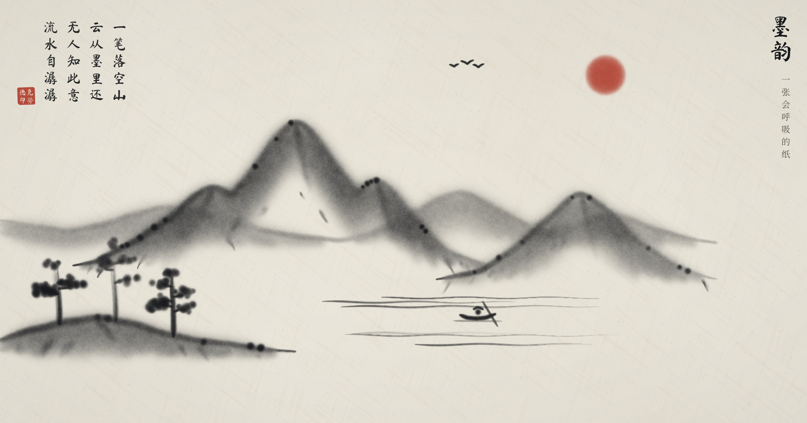

# 画与歌

[](https://opensource.org/licenses/MIT)
[](https://axtonliu.github.io/moyun/)

墨在显卡上实时解流体方程，每一笔都有琴声。看不见的手逐笔画出十种水墨场景，并为每幅画题诗、钤印。

**[打开体验 →](https://axtonliu.github.io/moyun/)** · [English](README.md)



## 怎么玩

- **看**：打开页面会自动画一幅山水。也可从底栏选择十种场景，并选择正面俯视、45°俯视或侧面视角；45°视角保留竖直建筑与树干，侧面山水的河流纵向穿过画面。场景生成优先搭配相应的古典诗词，没有合适篇章时使用原创短诗。
- **画**：选择毛笔、硬笔（铅笔）或硬毛笔，再选浓墨、朱砂、蓝、黄、绿或清水，以及细、中、粗笔锋。毛笔保留流动洇墨；硬笔绘制在独立图层，干爽清晰、不扰动水墨；硬毛笔以少量水产生轻微洇染。按住拖动即可作画。
- **搅**：选「清水」，在画好的画上用力搅一搅，墨会像被水冲开一样流动。
- **听**：琴声只用宫商角徵羽五个音，怎么画都不会走调。

## 背后

页面核心是一个 HTML 文件，人物使用 `media/figures/` 下的 15 张本地原创透明 PNG。无需运行时 JavaScript 库、外链图片或录音文件。

- **流体**：WebGL2 片元着色器求解不可压缩 Navier–Stokes，每帧依次做旋度、涡量约束、散度、24 次 Jacobi 压力迭代、梯度相减投影、半拉格朗日平流。
- **洇墨**：RGBA 四通道分别存游离墨、带符号色素（朱砂/花青）、水分和带符号色素（赭黄/石绿）。四种颜色随纸纤维噪声洇开，水分逐渐蒸发。
- **笔**：毛笔与硬毛笔沿路径等距盖高斯印章；硬毛笔使用低水量和低流体扰动。硬笔在独立透明画布上绘制，不进入流体仿真。三种笔均可选细、中、粗。
- **琴**：Karplus–Strong 拨弦物理模型合成，上滑与吟用 `playbackRate` 自动化实现。
- **场景**：十种带种子的构图由笔触逐步生成，每种场景都支持正面俯视、45°俯视和侧面视角。山水含六种随机视点，新增绝壁松风构图，远山、瀑布、亭阁、村落、日月云鸟会变化；校园、园林、溪畔和街景加入淡远山影、雾气或远屋。松、柏、垂柳、梅与灌木各有枝干形态，人物加入僧人、孩童、樵夫、渔夫和商贩。
- **参考构图**：`src_images/` 按文件名前缀对应已有场景：`山水`→山水、`银杏道`→银杏道、`图书馆`→图书馆、`溪畔`→溪畔行人、`林间飞鸟`→林间飞鸟、`昆明`→昆明街景。图片只用于构图参考，不会在页面运行时加载。

## 本地运行

```bash
git clone https://github.com/axtonliu/moyun.git
cd moyun
python3 -m http.server 8000
# 打开 http://127.0.0.1:8000/
```

需要支持 WebGL2 的浏览器（新版 Chrome、Edge、Safari、Firefox 均可）。

录制作画视频（16:9 与 9:16，含琴声）：

```bash
pip install playwright && python3 -m playwright install chromium
python3 scripts/record.py --url http://127.0.0.1:8000/ --out media
```

## 致谢

流体求解流程来自 Jos Stam《Stable Fluids》（1999）与 GPU Gems 第 38 章；Pavel Dobryakov 的 [WebGL-Fluid-Simulation](https://github.com/PavelDoGreat/WebGL-Fluid-Simulation) 让这套方法在网页上广为人知，也启发了着色器的组织方式。拨弦合成来自 Karplus 与 Strong（1983）。字体为马善政毛笔体、思源宋体、IBM Plex Mono（SIL OFL）。

本作品由 Claude（Opus 5.5）在一次对话中写成，起点是一句开放的邀请：做一件让每个看到的人都惊叹的事。

## 许可

MIT，见 [LICENSE](LICENSE)。

---

## Author | 作者

**Axton Liu** — AI Educator & Creator

- Website: [axtonliu.ai](https://www.axtonliu.ai)
- YouTube: [@AxtonLiu](https://youtube.com/@AxtonLiu)
- Twitter/X: [@axtonliu](https://x.com/axtonliu)

### Learn More

- [MAPS™ AI Agent Course](https://www.axtonliu.ai/aiagent) - Systematic AI agent skills training
- [Claude Skills: A Systematic Guide](https://www.axtonliu.ai/newsletters/ai-2/posts/claude-agent-skills-maps-framework) - Complete methodology
- [AI Elite Weekly Newsletter](https://www.axtonliu.ai/newsletters/ai-2) - Weekly AI insights
- [Free AI Course](https://www.axtonliu.ai/axton-free-course) - Get started with AI

---

© AXTONLIU™ & AI 精英学院™ 版权所有
